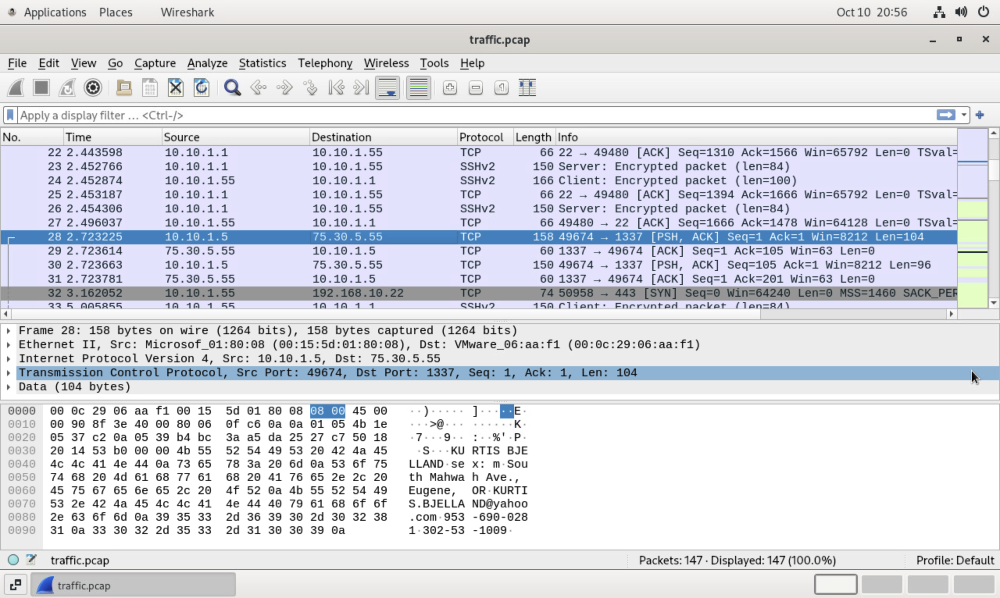
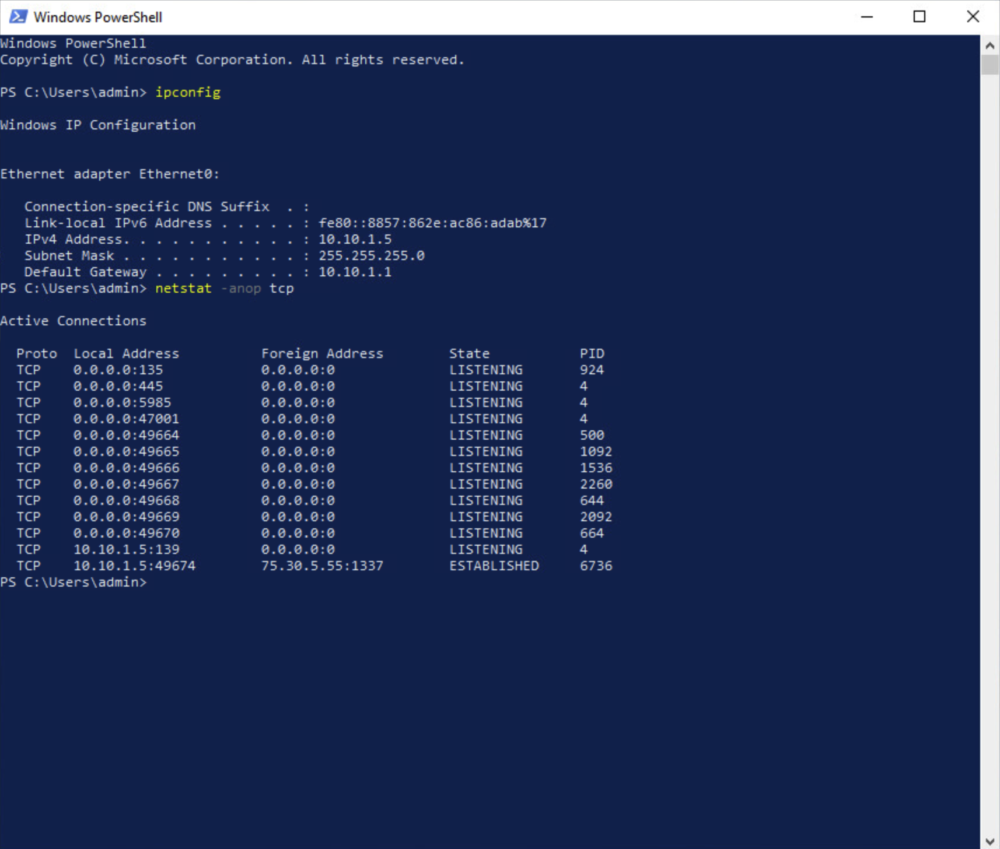
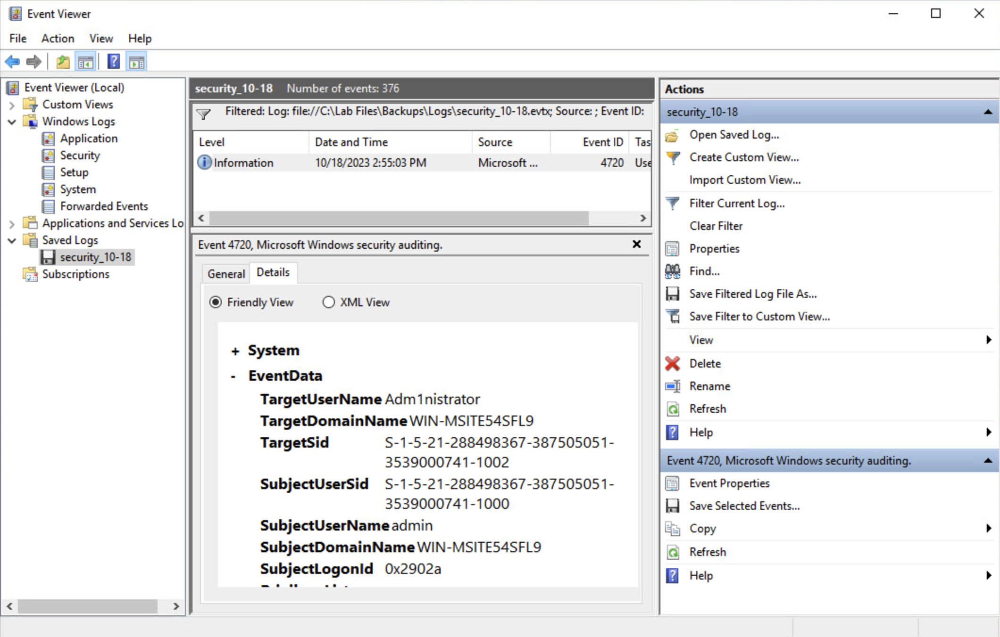
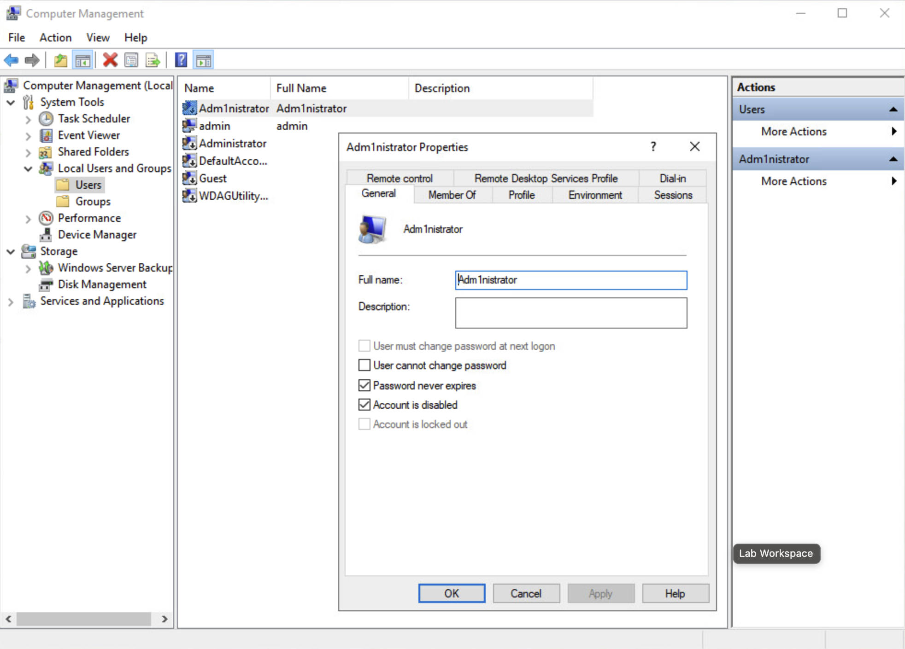
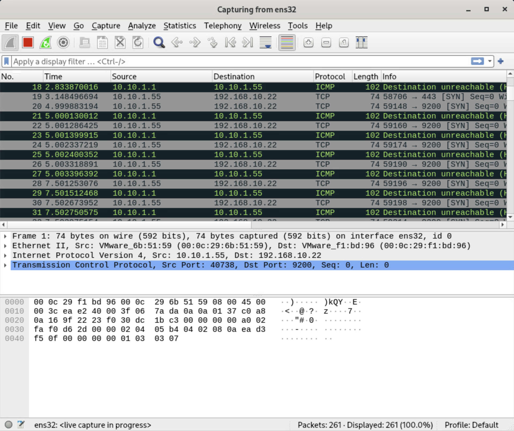

# Enterprise-Incident-Response-Investigation-and-Remediation

End-to-end SOC incident response analyzing network PCAP exfiltration in Wireshark, identifying host-level malware and backdoored accounts on Windows Server 2019, executing remediation, and validating containment.

---

## 📌 Executive Incident Summary
- **Organization:** Hexoto Enterprise Network
- **Initial Trigger:** Customer reports of phishing calls and identity misuse originating from internal client records.
- **Affected Server:** Windows Server 2019 (`10.10.1.5`)
- **Attacker Infrastructure:** External IP `75.30.5.55`
- **Root Cause:** Compromised host executing an unauthorized Trojan backdoor process coupled with an unencrypted command-and-control (C2) channel and an unauthorized administrative persistence account.
- **Impacted Data Classification:** Personally Identifiable Information (PII) and Payment Card Industry (PCI) records.

---

## 🛠️ Tooling & Investigative Environment
- **Network Forensics & Capture:** Security Onion 2.4.10, Wireshark, PCAP Stream Reconstruction
- **Host Forensics & Triage:** Windows Server 2019, PowerShell, TCP Socket Inspection (`netstat`), Windows Event Viewer, Task Manager, Local Users and Groups (`lusrmgr.msc`)
- **Framework Alignment:** NIST SP 800-61 Rev. 2 (Incident Handling Lifecycle: Detection, Analysis, Containment, Eradication, and Post-Incident Monitoring)

---

## 🔍 Investigation Workflow & Technical Findings

### 1. Network Telemetry & PCAP Analysis (Security Onion)
Network traffic inspection was performed on captured packet trace `traffic.pcap` using Wireshark on Security Onion:
- **Communication Flow:** Identified sustained TCP sessions established between internal host `10.10.1.5` and external IP `75.30.5.55`.
- **Payload Inspection:** Following the TCP Stream revealed raw ASCII, unencrypted HTTP transmission of sensitive internal records without cryptographic controls.
- **Data Identification:** Extracted customer names, addresses, credit card numbers, and Social Security numbers being exfiltrated in cleartext.

---

### 2. Host-Level Network & Process Triage (Windows Server 2019)
Pivoted to the compromised Windows Server (`10.10.1.5`) to link network sockets with active execution trees:
- Ran `ipconfig` to verify the primary adapter binding.
- Executed `netstat -anop tcp` to inspect active listening sockets and foreign address connections.
- Correlated the foreign destination socket (`75.30.5.55`) against the host process ID (PID), mapping the traffic to an anomalous binary.
- Cross-referenced running services and processes using Task Manager (`Details` tab), identifying `backdoor.exe` and `WinTools` actively executing from non-standard system directories.

---

### 3. Log Forensics & Persistence Mechanism Detection
Audited Windows Security Event Logs to determine how access was established and maintained:
- Filtered Windows Security Event Log for **Event ID 4720** ("A user account was created").
- Identified the creation of an unauthorized, typosquatted local account: `Adm1nistrator`.
- Compared `net user` output against Local Users and Groups (`lusrmgr.msc`), confirming that `Adm1nistrator` had been provisioned with elevated administrative rights to maintain persistence even if the initial session dropped.

---

## 🛡️ Containment, Eradication & Remediation

Following the confirmation of active C2 communications and unauthorized account creation, immediate containment actions were taken:

### 1. Account Persistence Neutralization
- Navigated to `Computer Management` ➔ `Local Users and Groups` ➔ `Users`.
- Located `Adm1nistrator` and accessed account properties.
- Enabled **Account is disabled** and enforced **Password never expires** (neutralized) to revoke immediate interactive access and token re-use.

### 2. Malicious Process Termination
- Located active process `backdoor.exe` within the process hierarchy.
- Issued process termination (`End Process`) to halt active memory execution.
- Removed malicious binary artifacts (`WinTools` / `backdoor.exe`) from the host filesystem.

---

## 📈 Post-Incident Verification & Monitoring

Containment validation was conducted to verify the malicious binary was not configured under automated resurrection mechanisms (e.g., Run keys, Scheduled Tasks):

1. **Host Verification:**
   - Ran `Get-Process -Name WinTools` in PowerShell; confirmed no running instances were present in memory.
2. **Network Retest & Live Capture:**
   - Initiated a clean 10-second packet capture using Wireshark on the Security Onion sensor.
   - Filtered traffic for destination `75.30.5.55`; confirmed zero packets egressed from the host network adapter, validating the termination of the exfiltration pipe.

---

## 📋 Lessons Learned & Hardening Recommendations
- **Egress Filtering:** Implement strict outbound firewall filtering on database/server subnets to deny direct outbound traffic to unknown public IPs over non-standard ports.
- **Data Loss Prevention (DLP):** Deploy network DLP rules capable of detecting unencrypted PCI/PII patterns (credit card formats, SSNs) exiting perimeter gateways.
- **Account Creation Alerting:** Configure SIEM detection alerts on Windows Security Event ID 4720 to flag non-standard account creation in real time.
- **Privilege Separation:** Enforce Local Administrator Password Solution (LAPS) to prevent unauthorized credential reuse across enterprise servers.
